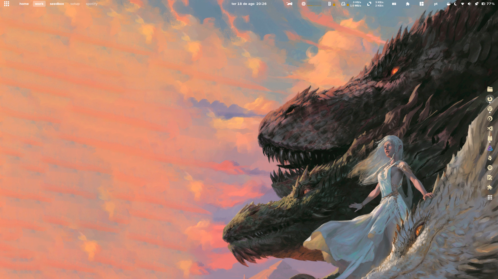

## Resumo do Sistema

| Componente | Tecnologia / Ferramenta |
| :--- | :--- |
| **OS** | Fedora Workstation |
| **Desktop** | GNOME + Pop Shell & Tiling Shell |
| **Shell** | Zsh + Starship prompt |
| **Gestor de Configs** | GNU Stow |

## Estrutura do Repositório

``` 
~/dotfiles/
├── btop/              # Configuração do monitor de sistema
├── fastfetch/         # Informações do sistema no terminal
├── gnome-rice/        # Configurações e scripts do GNOME
├── gtk/               # Temas e definições GTK
├── kitty/             # Emulador de terminal
├── mpv/               # Reprodutor multimédia
├── packages/          # Listas de pacotes DNF e Flatpak
├── photogimp/         # Ajustes visuais do GIMP
├── starship/          # Prompt do shell
├── system-fixes/      # Ajustes de hardware e systemd
├── zathura/           # Leitor de documentos
├── zsh/               # Configurações do Zsh
├── install.sh         # Script mestre de instalação
└── README.md          # Documentação
``` 

## Como Instalar

Para clonar o repositório e aplicar todas as configurações e ajustes automaticamente:
``` 
bash
git clone https://github.com/celedriel/dotfiles.git ~/dotfiles
cd ~/dotfiles
./install.sh
``` 


